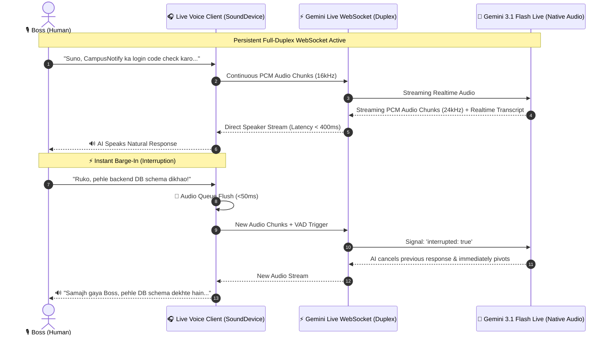

<p align="center">
  <h1 align="center">🎙️ Live Voice Responder</h1>
  <p align="center"><strong>Enterprise Full-Duplex Multimodal Voice Coordination Engine</strong></p>
  <p align="center">Powered by Google Gemini 3.1 Flash Live (Native Audio), Bidirectional WebSocket Streaming, Instant Barge-In (Interruption), and 3-Tier Neural TTS Fail-Safe for Antigravity, Claude Code, and Cursor.</p>
</p>

<p align="center">
  
  
  
  
  
</p>

---

## 🌟 Overview

**Live Voice Responder** bridges the gap between text-only coding prompts and real-time bidirectional vocal pair programming. Modeled directly on Google Gemini's Multimodal Live API, it eliminates awkward typing, pauses, and batch delays.

### Core Capabilities:
1. **⚡ True Full-Duplex Audio:** Continuous 16kHz PCM streaming from microphone and 24kHz raw PCM output streaming to speakers simultaneously over a single persistent WebSocket.
2. **🛑 Instant Barge-In (Interruption Handling):** When you speak while the AI is talking, the speaker buffer is instantly flushed within milliseconds, and the model pivots to your new instruction without hesitation.
3. **🧠 Native Multimodal Voice:** Understands subtle acoustic nuances, tone, pauses, and speech inflection directly without intermediate Speech-to-Text conversion delays.
4. **👑 Institutional Boss Persona:** Calibrated strictly for executive architectural collaboration—razor-sharp Hindi/Hinglish brevity, zero sycophancy, and high technical depth.
5. **🛡️ 3-Tier Zero-Fail Fallback:** If internet or API quotas drop, it seamlessly falls back to Edge-TTS Neural -> Google gTTS -> Windows SAPI5 to ensure 100% voice availability.
6. **🔌 Antigravity Chat Bridge:** Injects spoken commands directly into Antigravity IDE Chat box (`Ctrl+V` + `Enter`) automatically.

---

## 📐 Architecture & Flow



---

## 🚀 Quick Start

### 1. Installation
```bash
git clone https://github.com/ATP0925/live-voice-responder.git
cd live-voice-responder
pip install -r requirements.txt
```

### 2. Set Your Gemini API Key
```powershell
$env:GEMINI_API_KEY="your-gemini-api-key"
```

### 3. Launch Interactive Terminal HUD (Realtime Duplex Mode)
```powershell
python live_voice_cli.py
```

### 4. Or Run Silent Background Daemon (Global F8 Push-to-Talk)
```powershell
python live_voice_daemon.py
```

---

## ⚙️ Configuration (`config.json`)

Customize persona, voices, and audio buffer sensitivity:

```json
{
  "version": "2.0.0",
  "persona": {
    "callsign": "Boss",
    "language": "hi-IN",
    "tone": "executive_rigor"
  },
  "model": {
    "live_model": "gemini-3.1-flash-live-preview",
    "voice_name": "Puck",
    "thinking_level": "minimal"
  },
  "audio": {
    "input_sample_rate": 16000,
    "output_sample_rate": 24000,
    "interruption_enabled": true,
    "vad_threshold_energy": 0.015,
    "silence_duration_seconds": 0.75
  }
}
```

---

## 🧪 Testing

Execute test suite verifying configuration, interruption handling, and tool execution:
```bash
python -m unittest discover -s tests
```

---

## 🤝 License

Licensed under the [MIT License](LICENSE). Architected for Boss & Antigravity.
