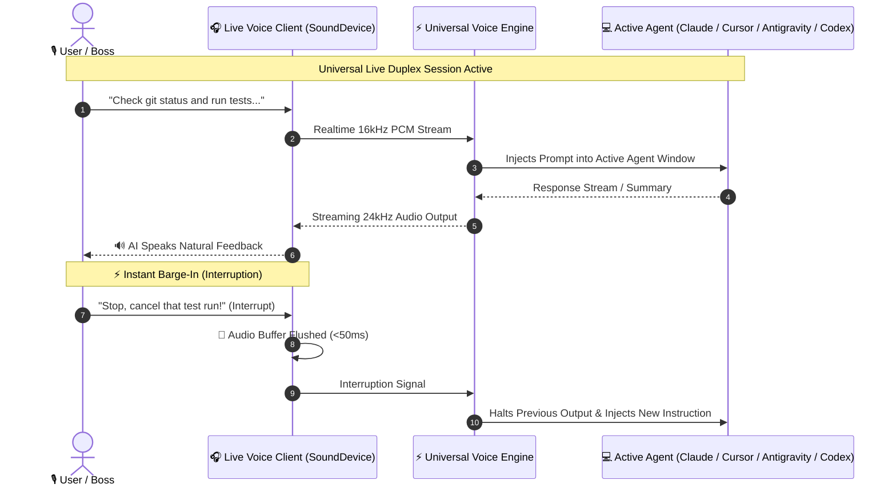

<p align="center">
  <h1 align="center">🎙️ Live Voice Responder</h1>
  <p align="center"><strong>Universal Full-Duplex Multimodal Voice Coordination Engine</strong></p>
  <p align="center">Engineered for <strong>Claude Code, Cursor IDE, OpenAI Codex / Copilot, Google Antigravity, and Windsurf</strong>.</p>
  <p align="center">Features Bidirectional Audio Streaming, Instant Barge-In (Interruption), Pluggable Multi-Provider Backend (Gemini / OpenAI / Anthropic / Local), and 3-Tier Offline Neural TTS.</p>
</p>

<p align="center">
  
  
  
  
  
</p>

---

## 🌟 Overview

**Live Voice Responder** is a vendor-neutral, universal voice coordination engine designed for modern AI coding assistants. Instead of being locked to a single AI provider, it functions as a modular bridge across:

* 🟠 **Claude Code** (Terminal)
* 🔵 **Cursor IDE**
* 🟢 **OpenAI Codex & GitHub Copilot**
* 🟣 **Google Antigravity IDE**
* 🌊 **Windsurf & Aider**

Users can seamlessly run it out-of-the-box, customize backend providers (`config.json`), switch models, or use local offline engines without vendor lock-in.

---

## ⚡ Core Capabilities

1. **🎙️ Universal Duplex Streaming:** High-performance bidirectional streaming (16kHz PCM input / 24kHz output) allowing natural two-way conversation with AI agents.
2. **🎧 Multi-Device Audio Routing:** Explicit hardware enumeration (`--list-devices`) and selection (`--device <id>`), supporting Bluetooth headsets (e.g. Aroma-NB119T PRO) and phone mic arrays (iQOO Neo).
3. **🔇 Instant Mute / Pause Toggle (Global F9 & Voice):** Press **`F9`** anytime (globally, even inside your code editor) or simply say *"mute mic"* / *"pause mic"* to pause microphone capture instantly with real-time visual and sound cues.
4. **🌪️ DSP 4th-Order Butterworth Fan Noise Cancellation:** High-grade 300Hz–3400Hz voice bandpass filter + dual-threshold hysteresis noise gate completely eliminates laptop fan whine and background noise.
5. **⚡ Spoken "Enter" Automation:** Say *"enter"* at the end of any command (e.g. *"run unit tests enter"*), and the engine automatically strips "enter" and triggers an instant physical `Enter` keystroke into the active chat.
6. **🛑 Sub-50ms Instant Barge-In & PID Anti-Echo Watchdog:** Speaker buffers flush immediately when you speak. PID-based lock detection prevents the microphone from capturing the assistant's own voice.
7. **🪟 Non-Destructive Window Focusing:** Injects text smoothly without resizing or unmaximizing editor windows, and without triggering the Windows `ALT` menu bar.
8. **🔌 Cross-Agent Chat Injection:** Detects whichever coding assistant window is active and automatically pastes and sends spoken prompts (`Ctrl+V` + `Enter`).
9. **🧩 Modular Multi-Provider Architecture:**
   * **`auto`**: Detects available environment keys (`GEMINI_API_KEY`, `OPENAI_API_KEY`, `ANTHROPIC_API_KEY`) and selects the optimal engine.
   * **`gemini`**: Native Multimodal Live API (`gemini-3.1-flash-live-preview`).
   * **`openai`**: OpenAI Realtime API (`gpt-4o-realtime-preview`).
   * **`anthropic`**: Claude Code Live pipeline with streaming voice.
   * **`local`**: 100% offline Faster-Whisper + Edge-TTS/SAPI5.
10. **👑 Customizable Callsign & Persona:** Calibrated by default for "Boss" with executive brevity and technical rigor in Hindi/Hinglish, yet easily customizable post-install in `config.json`.
11. **🛡️ 3-Tier Offline Neural Fail-Safe:** Edge-TTS -> Google gTTS -> Windows Native SAPI5 ensures voice output never goes silent even with zero internet.

---

## 📐 Universal Architecture & Flow



---

## 🚀 Quick Start

### 1. Installation
```bash
git clone https://github.com/ATP0925/live-voice-responder.git
cd live-voice-responder
pip install -r requirements.txt
```

### 2. Launch Interactive Duplex Mode
```bash
python live_voice_cli.py
```

### 3. Or Run Silent Background Daemon (Global F8 Hotkey)
```bash
python live_voice_daemon.py
```

---

## ⚙️ Configuration (`config.json`)

Post-installation, users can fully tailor the engine to their personal preferences, AI provider, and IDE:

```json
{
  "version": "2.1.0",
  "persona": {
    "callsign": "Boss",
    "language": "hi-IN",
    "tone": "executive_rigor"
  },
  "engine": {
    "provider": "auto",
    "gemini": {
      "model": "gemini-3.1-flash-live-preview",
      "voice_name": "Puck"
    },
    "openai": {
      "model": "gpt-4o-realtime-preview",
      "voice_name": "alloy"
    },
    "anthropic": {
      "model": "claude-3-7-sonnet"
    }
  },
  "agent_bridge": {
    "target_agent": "auto",
    "auto_focus_chat": true,
    "auto_send_enter": true
  }
}
```

---

## 🧪 Testing

```bash
python -m unittest discover -s tests
```

---

## 🤝 License

Licensed under the [MIT License](LICENSE). 100% original, clean-room universal implementation.
